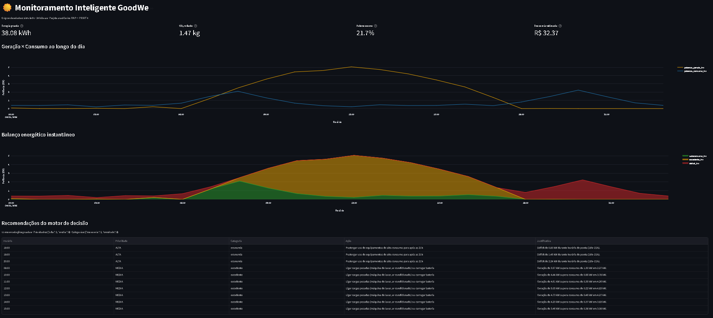
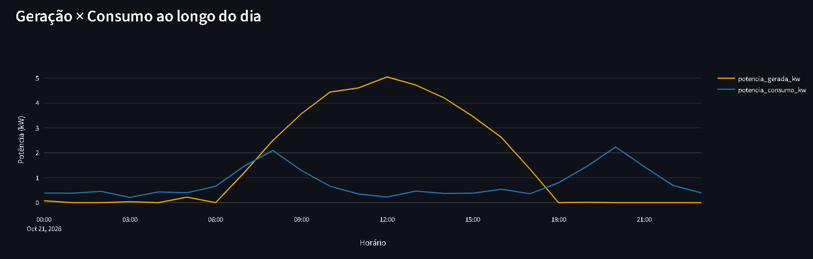
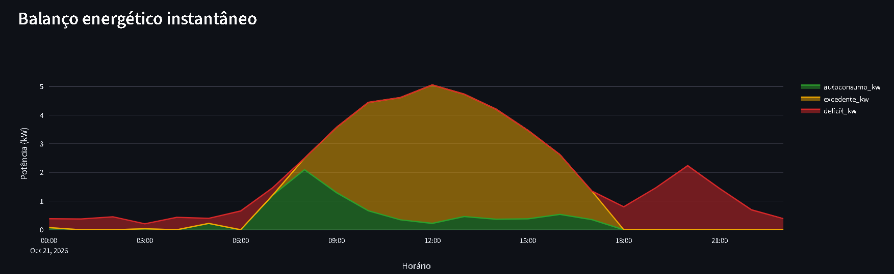
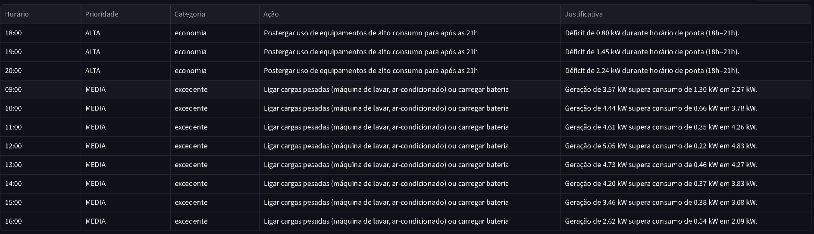

# ️ Sprint 4

> Projeto acadêmico FIAP — PRINT 4
> Solução integrada de monitoramento, análise e recomendação para sistemas fotovoltaicos GoodWe.

---

##  Equipe

| Nome | RM |
|---|---|
| João Guilherme Figueiredo | 572697 |
| Enzo Ricardo Silva | 571333 |
| Eric Hernandes Penhalbel | 574085 |
| Matheus Borges Soares | 570237 |
| Ryan Luther Roque | 572993 |

**Vídeo de demonstração:** [Assistir no YouTube (não listado)](https://youtu.be/SEU_LINK_AQUI)

---

##  O Desafio e a Solução

O desafio proposto pela **GoodWe** exige uma solução inovadora e sustentável. O ecossistema GoodWe já oferece o **SEMS+** (Smart Energy Management System), que faz monitoramento e agendamento baseado em IA. No entanto, a visualização de dados brutos e a tradução desses dados em **ações concretas** de economia e sustentabilidade ainda é um ponto de atrito para o usuário final.

Nossa solução preenche essa lacuna: é uma camada de software em Python que consome dados de geração (simulados ou reais via biblioteca `goodwe`), calcula métricas de sustentabilidade em tempo real, e utiliza um **motor de decisão baseado em regras** para gerar recomendações acionáveis.

O sistema é capaz de:
- Calcular a pegada de carbono evitada (CO₂).
- Identificar ineficiências no autoconsumo.
- Alertar sobre riscos operacionais (como superaquecimento do inversor).
- Sugerir ações para maximizar a economia na conta de luz.

---

##  Arquitetura da Solução

A arquitetura foi desenhada em três camadas para garantir modularidade e facilidade de integração com hardware real:

1.  **Camada de Dados (`src/simulator.py` e `src/goodwe_reader.py`)**: Responsável por obter os dados. O sistema tenta se conectar a um inversor GoodWe real via rede local (UDP/Modbus). Caso não encontre hardware, ele utiliza um simulador de dados fotovoltaicos realistas, garantindo a demonstração contínua.
2.  **Camada de Processamento (`src/analyzer.py` e `src/recommender.py`)**: Onde a inteligência reside. O analisador calcula as métricas energéticas e de CO₂. O recomendador aplica regras de negócio (ex: horário de ponta, excesso de geração, temperatura) para gerar ações.
3.  **Camada de Apresentação (`app.py`)**: Um dashboard interativo construído com **Streamlit** e **Plotly**, que permite ao usuário visualizar o balanço energético e as recomendações de forma clara e amigável.

---

##  Resultados e Funcionamento

Abaixo, os gráficos gerados pela solução em execução:

### 1. Geração vs. Consumo
O gráfico mostra a curva de geração solar (amarelo) contra o consumo da residência (azul). Nota-se o pico de geração ao meio-dia e os picos de consumo no início da manhã e à noite.

### 2. Balanço Energético Instantâneo
Esta visualização detalha o destino da energia:
- **Verde (Autoconsumo)**: Energia gerada e consumida instantaneamente.
- **Amarelo (Excedente)**: Energia gerada que não foi consumida (injetada na rede).
- **Vermelho (Déficit)**: Consumo que precisou ser puxado da rede.

### 3. Motor de Decisão (Recomendações)
Com base nos dados acima, o sistema gerou as seguintes recomendações:

**Métricas consolidadas do período:**
- **Energia Gerada:** 38.08 kWh
- **CO₂ Evitado:** 1.47 kg (Fator SIN: 0,0385 kg/kWh)
- **Autoconsumo:** 21.7%
- **Economia Estimada:** R$ 32.37

---

##  Alinhamento com a GoodWe e Sustentabilidade

A solução se alinha ao desafio da GoodWe ao propor uma gestão energética inteligente que vai além do monitoramento passivo.

- **Tecnologia GoodWe:** O código foi projetado para interagir com a biblioteca oficial `goodwe`, respeitando os sensores e a lógica de comunicação dos inversores da marca.
- **Sustentabilidade:** Ao calcular o CO₂ evitado e sugerir o aumento do autoconsumo (carregando baterias ou deslocando cargas), a solução atua diretamente na redução da pegada de carbono do usuário e na eficiência da matriz energética local.
- **Inovação:** A automação de recomendações e a visualização amigável em tempo real são diferenciais que facilitam a adoção de energia solar e a economia doméstica.

---

##  Como Executar o Projeto

1. Clone o repositório:
   git clone https://github.com/SEU_USUARIO/seu-repositorio.git
   cd seu-repositorio

2. Crie e ative o ambiente virtual (recomendado):
   python -m venv .venv
   .venv\Scripts\activate

3. Instale as dependências:
   pip install -r requirements.txt

4. Execute o dashboard:
   streamlit run app.py

---

##  Referências e Tecnologias

- **Python 3.14** e bibliotecas: `pandas`, `numpy`, `plotly`, `streamlit`.
- **Biblioteca GoodWe:** [Documentação oficial no PyPI](https://pypi.org/project/goodwe/).
- **Fator de Emissão CO₂:** Ministério da Ciência, Tecnologia e Inovação (MCTI) - Fator médio do SIN (2023).
- **Ecossistema GoodWe:** [SEMS+](https://www.goodwe.com/sems-plus).